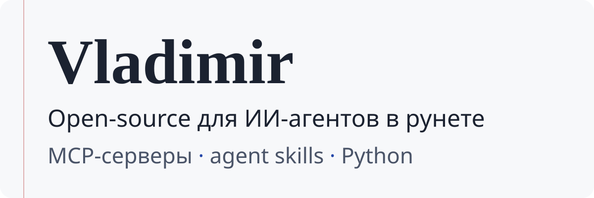

<picture>
  <source media="(prefers-color-scheme: dark)" srcset="assets/banner-dark.svg">
  
</picture>

### Привет, я Владимир

Делаю open-source для ИИ-агентов: MCP-серверы и agent skills для рунета. Пишу на Python.

<sub>EN: Open-source MCP servers and agent skills for the Russian-speaking web. Python.</sub>

## Проекты

### [ru-marketplace-mcp](https://github.com/Vladimir-Human/ru-marketplace-mcp)

[](https://github.com/Vladimir-Human/ru-marketplace-mcp/stargazers) [](https://github.com/Vladimir-Human/ru-marketplace-mcp/actions/workflows/ci.yml) [](https://pypi.org/project/ru-marketplace-mcp/)

Wildberries, Ozon, Яндекс Маркет, Авито, AliExpress, Циан и ещё шесть площадок РФ и Китая как MCP-серверы и agent skills. Только чтение, ключи API не нужны.

Сравнение цен одним вызовом ищет одну и ту же модель на разных площадках и отсеивает запчасти, аксессуары и подозрительно дешёвые копии.

```bash
uvx ru-marketplace-mcp setup
```

Команда сама находит установленные MCP-клиенты и подключает к ним сервер. Для Claude Desktop без терминала есть пакет `.mcpb` в [последнем релизе](https://github.com/Vladimir-Human/ru-marketplace-mcp/releases/latest), он проверен на Windows.

### [humanizer-ru](https://github.com/Vladimir-Human/humanizer-ru)

[](https://github.com/Vladimir-Human/humanizer-ru/stargazers) [](https://github.com/Vladimir-Human/humanizer-ru/actions/workflows/ci.yml) [](https://github.com/Vladimir-Human/humanizer-ru/releases)

Навык для Claude Code, Codex, Cursor и Gemini CLI: правит русский текст после нейросети и сверяет цифры, даты и имена. Помогает подготовить текст к проверке в «Антиплагиате» и ИИ-детекторах.

```bash
npx skills add Vladimir-Human/humanizer-ru
```

Без установки, прямо в браузере: [проверка стиля и скрытых символов](https://vladimir-human.github.io/humanizer-ru/check/) и [сверка фактов до и после правки](https://vladimir-human.github.io/humanizer-ru/sverka/). Страницы работают офлайн, текст не покидает вкладку.

## Свежие релизы

<!--RELEASES:START-->
- **ru-marketplace-mcp** [v2.11.2](https://github.com/Vladimir-Human/ru-marketplace-mcp/releases/tag/v2.11.2) · 21 ноября 2026
- **humanizer-ru** [v4.4.0](https://github.com/Vladimir-Human/humanizer-ru/releases/tag/v4.4.0) · 22 ноября 2026
<!--RELEASES:END-->

## Как я работаю

- **Проверка важнее уверенности.** Код пишу вместе с ИИ-ассистентами, а они ошибаются уверенно, поэтому проекты держатся на офлайн-тестах и сверке с живыми страницами.
- **Не выдумывать значение.** Нет цены — это `null`, а не 0. Сменился формат — громкая ошибка, а не полуразобранные данные.
- **Факты не трогать.** Стиль можно править, цифры, даты, имена и оговорки должны остаться прежними, и скрипт это проверяет.

**Связаться:** баги и вопросы — в issues ([ru-marketplace-mcp](https://github.com/Vladimir-Human/ru-marketplace-mcp/issues), [humanizer-ru](https://github.com/Vladimir-Human/humanizer-ru/issues)), идеи и обсуждения — в Discussions ([ru-marketplace-mcp](https://github.com/Vladimir-Human/ru-marketplace-mcp/discussions), [humanizer-ru](https://github.com/Vladimir-Human/humanizer-ru/discussions)).
