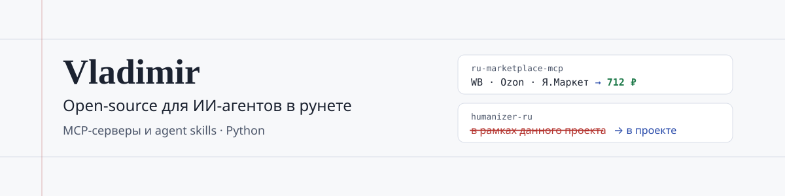

<picture>
  <source media="(prefers-color-scheme: dark)" srcset="assets/banner-dark.svg">
  
</picture>

### Привет, я Владимир

Делаю open-source для ИИ-агентов: MCP-серверы и agent skills для рунета. Пишу на Python.

EN: Open-source MCP servers and agent skills for the Russian-speaking web. Python.

## Проекты

| Проект | Что даёт | Состояние |
|---|---|---|
| [**ru-marketplace-mcp**](https://github.com/Vladimir-Human/ru-marketplace-mcp) | Wildberries, Ozon, Яндекс Маркет, Авито, AliExpress и другие площадки РФ и Китая как MCP-серверы и agent skills. Сравнение цен одним вызовом, только чтение, ключи API не нужны. `uvx ru-marketplace-mcp setup` |    |
| [**humanizer-ru**](https://github.com/Vladimir-Human/humanizer-ru) | Навык для Claude Code, Codex, Cursor и Gemini CLI: правит русский текст после нейросети и сверяет цифры, даты и имена. [Сайт со сравнением](https://vladimir-human.github.io/humanizer-ru/). `npx skills add Vladimir-Human/humanizer-ru` |    |

## Как я работаю

- **Проверка важнее уверенности.** Код пишу вместе с ИИ-ассистентами, а они ошибаются уверенно, поэтому проекты держатся на офлайн-тестах и сверке с живыми страницами.
- **Не выдумывать значение.** Нет цены — это `null`, а не 0. Сменился формат — громкая ошибка, а не полуразобранные данные.
- **Факты не трогать.** Стиль можно править, цифры, даты, имена и оговорки должны остаться прежними, и скрипт это проверяет.

## Свежие релизы

<!--RELEASES:START-->
- **ru-marketplace-mcp** [v2.9.1](https://github.com/Vladimir-Human/ru-marketplace-mcp/releases/tag/v2.9.1) · 6 ноября 2026
- **humanizer-ru** [v4.2.1](https://github.com/Vladimir-Human/humanizer-ru/releases/tag/v4.2.1) · 10 ноября 2026
<!--RELEASES:END-->

Вопросы и идеи — в issues нужного репозитория.
